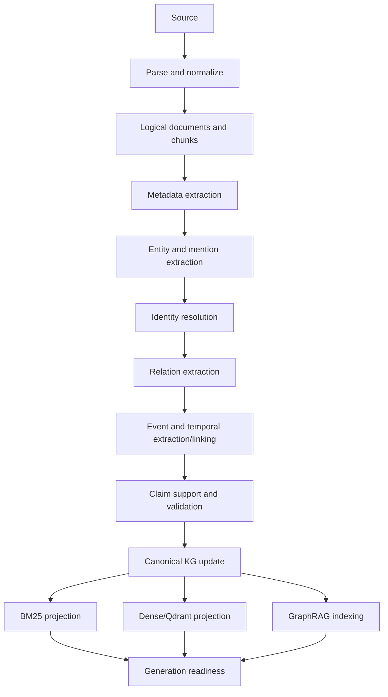

# Query V2 knowledge construction contract

> Status: Canonical construction and lifecycle are incomplete / blocked. This document records the
> intended boundaries and current implementation, not production acceptance for canonical entities,
> relations, properties, exhaustive population, or Neo4j as durable canonical authority.

## Knowledge and graph ownership

The upper ontology is deliberately small: `Entity` (including Person, Organization, Location,
Asset/Property and dynamic subtypes), `Document`, `LogicalDocument`, `Event`,
`TemporalExpression`, `Claim`, `Evidence`, and `Fact`. Dynamic domain properties and relations are
schema-governed extensions rather than a growing closed taxonomy.

Neo4j is the persistent/queryable canonical knowledge graph. Raw/extracted and canonical knowledge
are logically separated in the same database with explicit workspace, layer, generation, state,
and provenance markers. Application code never uses the Neo4j driver outside a Cortex-owned graph
adapter. The adapter enforces workspace scope, typed reads/writes, transaction boundaries, and
sanitized trace output.

Microsoft GraphRAG is Neo4j-backed behind its Cortex adapter. Its extraction outputs populate the
raw/extracted layer and may propose canonical changes; they do not become canonical truth merely
because GraphRAG produced them. Local, Global, and DRIFT read their approved views and return typed
findings to the common Result & Evidence Layer.

Phase 03 foundation status: Neo4j Community deployment, authenticated health, the workspace-scoped
graph adapter, extracted/canonical logical labels, atomic GraphRAG extraction synchronization, and
a non-final typed GraphRAG finding envelope are implemented. Native GraphRAG Parquet/JSON remains
the active V1 query source until the later Result & Evidence and sharp-cutover phases.

Phase 04 foundation status: the upper ontology, opaque UUID identity, aliases, original mentions,
exact-source provenance, relation/event/temporal contracts, evidence-gated claim transitions,
explicit contradictions, and precedence are implemented under `app/knowledge/`. The Neo4j adapter
persists canonical entities, claims, facts, conflicts, exact evidence chains, and lossless identity
operations. The workspace curation API/UI exposes merge, split, alias add/remove, evidence
inspection, and history.

Phase 05 delivery status: SQLite persists opaque workspace-scoped candidate generations, durable
run context, and every construction checkpoint. The specialized worker snapshots active chunks,
extracts uncached chunks in a bounded provider-concurrency batch, then checkpoints each validated
chunk artifact so it can resume the same candidate after interruption. A per-request provider
deadline bounds stalled calls; failures remain visible on the durable stage rather than silently
holding the candidate. GraphRAG runs through a separately bounded CLI subprocess; its command
deadline is a global setting and must expire as a durable stage failure rather than a worker-thread
interruption. All model/store calls run outside SQLite transactions. Retrieval activation requires only matching
source/relational, BM25, and dense/Qdrant projections; canonical and GraphRAG failures become
durable unavailable capability states. BM25 files, Qdrant points, and Microsoft GraphRAG artifacts
are generation-scoped. Readiness is exposed at
`GET /workspaces/{workspace_id}/knowledge/readiness` and in the knowledge curation UI. A failed or
mixed-generation retrieval projection cannot replace the prior active generation.

Provider output enters through a typed extraction envelope for mentions, relations, events,
temporals, and claims. Before any promotion, every assertion span must identify a snapshot chunk
and exactly equal the declared substring. Relation/event/claim references must resolve to mentions
inside the same envelope. Temporal `original_text` must equal its exact span, and approximate or
unknown temporal values must retain uncertainty. Successful validation materializes the complete
workspace/document/version/logical-document/chunk/span plus run/provider/model/prompt/schema chain.
The worker-owned provider adapter invokes OpenAI Structured Outputs outside database transactions,
decodes the strict envelope, and applies exact-span validation. Incorrect offsets may be corrected
only when the literal quote has one unambiguous occurrence or one uniquely nearest occurrence.
After bounded model repair, non-literal assertions and their dependent assertions are rejected at
the boundary and counted; they are never promoted. Provider output remains only a proposal until
canonical promotion applies identity and authority rules.

## Identity, claims, and provenance

Canonical entities use stable opaque IDs. Every mention retains original text, exact source span,
normalized form, extraction run, candidate links, decision, confidence, and model/schema versions.
Auto-merge requires conservative evidence; merges, splits, aliases, rejected candidates, and
superseded identities have lossless history. Manual merge, split, alias add/remove, evidence
inspection, and history are first-class curation operations.

The initial conservative auto-link policy requires exactly one same-upper-type candidate with an
exact normalized name and corroboration from at least two evidence records in two distinct document
versions. Any ambiguity remains unresolved. Canonical IDs are UUIDs and never derive from names or
source text. Merge retains one stable primary ID, tombstones superseded identities, transfers active
mention/alias links, and records its sources/results/evidence/reason. Split requires every active
mention to be assigned exactly once, creates new opaque IDs, and retains the source identity plus a
lossless operation record. Alias removal is an inactive user-curated tombstone, not deletion.

The extraction lifecycle is explicit: `unresolved` is retained as an evidence-bearing proposal and
never creates a canonical node; `new_canonical` may mint a UUID only after type-specific validation;
and `auto_link`/`manual_link` attach a mention to an existing canonical ID. For People, comparison
normalization folds case (including Turkish dotted/dotless-I), titles, context prefixes, punctuation,
and parenthetical variants while keeping the original mention and exact source span. One-token
names, initials, and other fragments cannot mint extracted canonical People. A valid variant is an
alias or mention of the same identity, not a second display-name node.

Every extracted property is bound to its referenced resolved mention: its chunk must match and its
exact span must be enclosed by that mention's span. Relations, events, and claims require resolved
endpoint bindings before materialization. Therefore a nearby surname or co-occurring name cannot be
assigned to another Person, and unresolved/ambiguous mention IDs cannot enter canonical relations.

Claims move through `ExtractedClaim → SupportedClaim → VerifiedFact`. Support requires source
evidence; verification requires an applicable deterministic or reviewed validator. Conflicting
claims are linked and retained, and facts/relations can expose `conflicted`. User curation outranks
validated knowledge, which outranks extracted proposals.

Every assertion records the source chain through exact span plus extraction run, provider/model,
prompt and schema version, confidence, validation state, generation, and original source text.
Temporal values additionally retain normalized value/range, role, precision, and uncertainty.
The exact span contract requires the declared offset length to equal the preserved source text.
Canonical relations require explicit exact-span, deterministic-rule, or user-curated support;
chunk co-occurrence is not a supported relation source. Approximate and unknown temporal values
must remain marked uncertain.

## Indexing V2 pipeline



Entity, relation, event, temporal, and claim extraction happens at ingestion/indexing time. All
stages are idempotent, workspace-scoped, generation-aware, and provenance-bearing. Reprocessing may
replace extracted proposals for that generation, but it cannot erase higher-precedence curated or
validated decisions. Quality takes priority over cost; selected provider/model and extraction
versions are recorded.

Before rebuilding one candidate generation, the canonical graph adapter removes that generation's
rebuildable extracted mentions, properties, relations, and artifacts, then rematerializes only
accepted identity decisions. Canonical identity nodes are never physically discarded by generation
cleanup: extracted identities with no accepted mention decision are retired and remain auditable by
their opaque ID, while user-curated and validated knowledge is preserved. Candidate matching
considers active accepted identity evidence only, so retired, failed, or stale identities cannot
influence a later generation.

## Immutable generation source manifest

Every candidate generation has one immutable authority record at
`knowledge-candidates/<generation_id>/source/manifest.jsonl`.  It is a
canonical JSONL serialization of the single `CorpusSnapshot`, ordered by
`document_id`, `document_version_id`, `logical_document_id`, chunk index, and
`chunk_id`.  `KnowledgeGeneration` persists only its relative URI, SHA-256 of
the exact bytes, and authoritative source chunk count.

```text
CorpusSnapshot -> source/manifest.jsonl
                    |- BM25 projection
                    `- Dense/Qdrant projection
```

BM25 evidence and every candidate Qdrant point carry the manifest chunk,
document/version/logical-document, generation, and content-hash identity.
Before readiness, candidate construction reads both projections back and
requires exact membership and identity equality with the snapshot.  Before the
final gate, the manifest loader recomputes its byte hash, validates all JSONL
records, and compares manifest membership/content hashes with both projection
checkpoints.  Missing, modified, cross-workspace, cross-generation, duplicate,
or malformed manifests fail closed.  Candidate generations without this
metadata are not eligible for V2 trusted-source use; no query-time backfill or
live relational fallback is permitted.
## Generation readiness and cutover

A generation is retrieval-ready when source/relational, BM25, and dense/Qdrant are ready for that
exact generation and agree with the immutable manifest. That gate enables
`retrieval.grounded`; it does not make a canonical or GraphRAG claim. Canonical construction stages
independently enable `canonical.exhaustive` and `canonical.graph`; GraphRAG independently enables
`graphrag.grounded`. An unavailable family fails closed for its own request without blocking
grounded retrieval or permitting a retrieval substitute for exhaustive answers.

V2 migration performs schema/config migration, fully reprocesses source material, validates the
retrieval authority, runs acceptance evaluation, and then atomically activates the V2 retrieval
generation. Neo4j readiness is required only by canonical capability families, not by normal V2
retrieval cutover. The previous active generation remains available until successful activation.
There is no long-running dual V1/V2 execution mode.

The readiness records are `knowledge_generations` and `knowledge_stage_states`. Stage executors
receive an immutable `CorpusSnapshot` and the opaque candidate generation ID. Their result must
echo both the generation ID and source fingerprint and provide a non-empty output fingerprint.
This prevents a stale external projection from being credited to a newer corpus snapshot.

Phase 13 adds a second, deliberately separate runtime gate. The retrieval generation may become
active after its three retrieval projections pass, but live query routing does not move from V1 to
V2 until schema/config/runtime preflight, a fresh corpus fingerprint, a before/after
user-curation fingerprint, and the acceptance evaluation all pass. The durable
query_runtime_activations row is the only live pointer; every accepted or rejected attempt is
recorded in query_cutover_attempts. Rejection never mutates that pointer.

Neo4j curation preservation is checked over every user-curated canonical entity, alias (including
inactive tombstones), and identity operation. Preflight collection and evaluation happen before
the short SQLite activation transaction. Read-only operational state is exposed at
GET /workspaces/{workspace_id}/knowledge/cutover.
