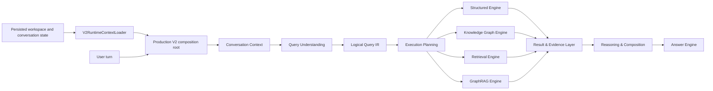

# Query V2 runtime contract

## Production status

Production query execution is V2-only. The stable chat API executes this chain:

```text
POST /chat
→ V2RuntimeContextLoader
→ V2QueryServiceFactory
→ semantic planner / Logical IR
→ physical plan + immutable GenerationScope
→ generation-bound dense + sparse retrieval / RRF
→ EngineResult + trusted manifest validation
→ ReasoningPackage
→ AnswerEngine
→ durable citations and API response
```

`production_chat.py` persists the request in a short transaction, executes the detached service,
then persists the answer, generation, trace, status, and citations in a second short transaction.
There is no V1 branch or automatic fallback.

The live service executes a generation-bound physical DAG. Retrieval, structured canonical,
canonical-graph, and GraphRAG steps are dispatched through a request-scoped engine registry and
converge through the same Result & Evidence boundary. The planner may include
`structured.enumerate` as a non-material document source-scan prerequisite. GraphRAG Local,
Global, and DRIFT read only the selected generation's normalized artifacts; the bridge rejects an
artifact unless its complete source identity resolves to one trusted source chunk and exact span.

This document defines the active production query architecture. Production query execution is V2-only.



## Conversation Context

Conversation Context is first-class, durable conversation-local state. It carries bounded message
history, summaries, last resolved entities, temporal focus, candidate references, explicit user
constraints, planner-visible assumptions, and the last final canonical entity-result set. A
follow-up such as “Peki çocukları?” may resolve against the prior entity, but that resolution never
mutates workspace-global canonical knowledge. Ambiguous carry-over remains explicit.

Phase 06 implements this target behind the inactive V2 boundary. `conversation_contexts` stores one
versioned, optimistically revised state document per workspace/conversation while bounded turns and
the existing summary are read from `messages` and `conversations`. Loads and writes require both
workspace and conversation identity; cited source messages are verified against the same pair.
Planner snapshots are detached before any provider request, and state persistence is a separate
short transaction. Context state never writes to canonical workspace knowledge.

## Query Understanding

The Semantic Planner is LLM-backed and schema-constrained. Settings assign simple, standard, and
complex planner model tiers. Complexity or ambiguity may escalate a request to a stronger tier and
may yield multiple candidate interpretations. Output contains no `intent` field and makes temporal
roles explicit: event date, document date, mentioned date, range, before/after event, approximate
date, and partial date.

Malformed or semantically invalid output is rejected, safely repaired/replanned within configured
bounds, or returned as ambiguous/unsupported. Analytic/count-and-order query shapes start at the
standard planner tier even when short. If all bounded planner repairs fail, production persists an
`unsupported` response with a sanitized `semantic_planner_output_invalid` reason; provider output
and validation details are never exposed. Provider prose is never treated as executable IR.

Known unsupported exhaustive relation aggregates are rejected deterministically before a planner or
retrieval call. In particular, the live scope cannot count property records per person and rank the
people: only the governed `person.surname` population analytics are authoritative today. The chat
response records `relation_aggregation_unsupported` and explains this limitation rather than asking
the user to restate an already explicit request.

The Phase 06 semantic contract is `SemanticUnderstanding` schema version `1.0`. It contains typed
entities, targets, relations, semantic operators, coverage, candidate interpretations, explicit
ambiguity/unresolved questions, and temporal constraints; it contains neither V1 `intent` nor an
engine/route choice. Simple, standard, and complex provider/model assignments are global settings.
Selection uses request/context shape, then bounded schema repair and quality escalation. The
OpenAI adapter requests strict Responses JSON Schema output, and Cortex validates it again before
use. Provider calls accept only detached snapshots and do not receive a database session.

Follow-up carry-over is deterministic after semantic validation. Only an entity explicitly marked
as a follow-up may inherit the latest compatible resolved conversation entity. Multiple active
candidates remain candidate interpretations; absent focus remains unresolved. Temporal carry-over
preserves original text, semantic role, normalized bounds, precision, uncertainty, and event anchor.
The resulting state may be persisted locally but cannot mutate the canonical graph.

Conversation-result referents are a separate typed semantic reference kind. After a successful
chat turn, only the final `ReasoningPackage.entities` canonical IDs, their common type, generation,
and assistant source message are persisted. On a later turn the result set is usable only when its
type and immutable generation match the active scope; otherwise it stays unresolved. It lowers to a
plural `ResolveNode` and therefore feeds graph traversal directly—answer prose, message-text parsing,
retrieval, and embeddings never select the referent.

## Logical Query IR

Logical Query IR is a versioned, typed DAG independent of physical engines. Extensible operator
families include `Scan`, `Resolve`, `Filter`, `Traverse`, `Join`, `Distinct`, `Group`, `Aggregate`,
`Count`, `Rank`, `Sort`, `Limit`, `Project`, `TemporalConstraint`, `RetrieveEvidence`, `Compare`,
`Exists`, `Summarize`, and `CustomCapability`. The schema represents targets, relations,
constraints, temporal semantics, coverage, output projection, evidence requirements, ambiguities,
and candidate plans without growing a closed intent taxonomy.

Validation covers schema version, types, field/relation validity, DAG integrity, coverage
compatibility, workspace scope, and evidence requirements. Invalid IR cannot reach an engine.

Phase 07 implements this contract behind the inactive V2 boundary as `LogicalQueryIR` schema
version `1.0`. Nineteen discriminated operator nodes cover scan, resolution, filtering, traversal,
joins, distinct/group/aggregate/count, rank/sort/limit/project, temporal constraints, evidence
retrieval, comparison, existence, summarization requests, and governed custom capabilities. Nodes
declare logical input/output types and form an acyclic graph whose every node must contribute to a
root. Output projection, evidence requirements, and coverage are separate typed contracts.

Validation is fail-closed before execution planning. Source nodes repeat the workspace boundary;
fields, resources, relations, and extension capabilities must exist in an injected workspace schema
snapshot. Dynamic relations remain possible without turning the IR into a closed ontology. Type
flow, upstream projection lineage, root/output compatibility, exhaustive population boundaries,
same-generation requirements, and exact-span provenance requirements are checked together. Count,
group, min/max/other aggregate, rank/top-N, and population comparison cannot use grounded top-k
coverage. Safe repair is limited to schema-version insertion and removal of duplicate graph
references; it never invents meaning or accepts undeclared vocabulary.

Deterministic lowering converts validated Phase 06 semantic understanding into resolved,
ambiguous-candidate, or unresolved IR. Underspecified filter/aggregate/order semantics remain
unresolved rather than being guessed. The IR contains no provider, route, storage query, or physical
engine choice and is not yet connected to the V1 chat entrypoint.

## Execution Planning

Execution Planning translates valid logical IR into a typed physical DAG. It chooses capabilities
from readiness and correctness requirements rather than static routes. Each step declares engine,
inputs, outputs, dependencies, generation/readiness preconditions, coverage expectation, fallback,
failure policy, and trace metadata.

Optimization order is correctness, evidence quality, coverage, reasoning quality, latency, then
cost. Cost is only a tie-breaker between quality-equivalent plans. Local, Global, and DRIFT are
GraphRAG capabilities. A multi-engine request produces real dependent/parallel steps and explicit
result reconciliation, not a route tuple.

Phase 08 implements this boundary behind the inactive V2 runtime as `PhysicalExecutionPlan`
schema version `1.0`. The planner consumes validated IR and an injected, detached readiness
snapshot; it performs no engine, provider, or database calls. Capability declarations are scored
lexicographically in the documented quality order. Workspace, active-generation, mandatory-
projection, and coverage compatibility are checked before a step is emitted. Exhaustive plans fail
closed and cannot degrade to grounded retrieval. Ambiguous meanings retain candidate physical
DAGs, while missing compatible readiness produces an explicit unsupported state. Every ready graph
ends in the Phase 09 `evidence.reconcile_and_validate` convergence capability. Production dispatch
uses the V2 registry; it remains independent of the legacy V1 chat runtime.

The production runtime uses the V2 execution boundary beneath the physical plan. It resolves
GenerationScope with workspace, generation, and embedding configuration exactly once, then passes
that snapshot unchanged to each planned read. Dense retrieval calls generation-bound Qdrant and
requires all three identities. Sparse retrieval loads only
knowledge-candidates/<generation>/bm25, validates artifact workspace/generation metadata, and
cannot fall back to a legacy workspace BM25 index. Returned identity mismatches fail closed. The
internal trace records the resolved scope, planned engine, separate dense/sparse counts, and a
logical sparse artifact identity. The V2 service then performs fusion, final-root result selection,
evidence reconciliation, and AnswerEngine delivery.

## Execution engines

- Structured Query Engine deterministically enumerates canonical populations and performs filter,
  distinct, count, group, rank, min/max, top-N, projection, and population comparison. It returns
  bounded uncertainty such as confirmed count and unresolved candidates when safe enumeration is
  impossible.
- Knowledge Graph Engine resolves canonical entities and executes relation, multi-hop, event,
  temporal, contradiction, and provenance traversal through the Cortex graph adapter only.
- Retrieval Engine performs workspace-filtered dense and sparse retrieval, fusion, reranking, and
  source evidence lookup. It supports grounded discovery but never claims exhaustive coverage.
- GraphRAG Engine preserves Local, Global, and DRIFT behavior over generation-bound extracted and
  community artifacts. It never admits Microsoft GraphRAG CLI native-answer prose: only normalized
  artifact findings with exact workspace, generation, document, version, logical-document, chunk,
  and content-hash identities become `GraphRAGFinding` and exact evidence in an `EngineResult`.

Every engine consumes typed plan inputs and emits a typed `EngineResult` containing the applicable
structured rows/entities, graph paths, aggregates, text evidence, GraphRAG findings, claims/facts,
provenance, completeness, confidence, ambiguity, contradictions, and sanitized execution trace.

Phase 10 implements the Structured and Knowledge Graph engines behind the inactive V2 boundary.
Structured execution operates on detached, evidence-bearing canonical population snapshots and
supports enumeration, filter/join/distinct/group/count/aggregate/rank/top-N/sort/limit/project,
temporal filter, existence, and population comparison. A bounded canonical snapshot reports its
exact candidate and confirmed counts; truncation or unresolved evidence becomes
`not_safely_enumerable`, never an approximate exhaustive result. Graph execution uses only the
Cortex-owned Neo4j adapter for canonical lookup, bounded multi-hop relations, event participation,
temporal constraints, provenance, and conflicts. Canonical relation/event/temporal links are
materialized with workspace and generation properties, and all findings retain exact evidence.
Neither engine is wired into V1 chat or permitted to author final prose.

## Result & Evidence Layer

This layer is the mandatory convergence boundary. It validates workspace and generation, converts
engine-specific output to common types, deduplicates compatible results, preserves disagreement,
validates provenance and completeness, ranks evidence, and materializes exact-span citations. A
partial engine failure cannot be reconciled into a complete result. Its output is a trustworthy,
typed package for reasoning or direct answering.

Phase 09 implements this boundary behind the inactive V2 runtime as `EngineResult` and
`ReasoningPackage`, both schema version `1.0`. Results are checked against their planned step,
engine, and capability. Reconciliation uses detached trusted-source snapshots and verifies each
workspace, generation, document, version, logical document, chunk, offset, and exact substring
before evidence can support a result or citation. Compatible evidence/results are merged;
different values remain explicit conflicts. Missing steps, invalid spans, projection gaps,
mixed generations, engine failures, and ambiguity remain visible and prevent an unjustified
complete state. GraphRAG prose remains a grounded finding and cannot become a final answer. The
layer performs no external calls or persistence and remains unwired from V1 chat.

## Reasoning & Composition

Reasoning combines trustworthy result packages across steps while retaining claim-level lineage.
Large goals are durable `ResearchRun` or `CompositionRun` workflows with checkpoints, subqueries,
evidence collections, outline/section state, and validation state; they are not forced into one
Query IR. Long-form artifacts retain internal paragraph- or sentence-level provenance and can
resume safely through the existing workflow infrastructure.

## Answer Engine

Only the Answer Engine creates and persists the final assistant response. It receives reconciled
results, applies grounding/consistency and answer-state rules, renders uncertainty and coverage,
and emits citations traceable to exact source spans. It cannot upgrade ambiguity, partial evidence,
or mixed-generation results to confident or corpus-complete output.

Phase 13 provides the pure rendering boundary at `app/query/answer.py`. It accepts only a
`ReasoningPackage`, keeps unsupported and ambiguous states fail-closed, and derives its citation
payload only from reconciled citations. The API adapter owns short-transaction message
persistence and must call this boundary only after planning and execution complete.

The detached preparation service at `app/query/runtime.py` composes a planner result through
Logical Query IR validation and physical execution planning. `V2RuntimeContextLoader` snapshots
persisted workspace, conversation, readiness, and production-generation state. The production
composition root at `app/query/production.py` then binds the configured semantic planner and query
embedder, shared Qdrant client, generation-bound dense store, generation-owned BM25 store,
`V2PlanExecutor`, trusted manifest loading, reconciliation, and `AnswerEngine` into one
`V2QueryService`. Expensive configured clients are factory-owned; `GenerationScope` and its
resolver remain immutable and request-scoped. Deterministic internal acceptance exercises this
same composition with injected external-provider adapters. It does not import V1 chat synthesis,
use workspace-only dense search, load legacy BM25, change `POST /chat`, or move either production
pointer.

Before a selected-model planning call, the production runtime loads a bounded, workspace-and-generation
scoped canonical identity catalogue when the canonical graph is configured. It contains opaque IDs,
entity types, display names, and active aliases only; it never contains document text, chunks,
evidence spans, or graph data. The runtime independently resolves only unique exact
display-name/alias matches, retains collisions as unresolved, and rejects a briefing that does not
match the active planning generation. Retrieval remains available when the graph infrastructure is
not configured; graph-dependent plans still fail closed through readiness.

## Governed property vocabulary

The active runtime extends its base IR vocabulary only from resolved canonical entity properties
in the selected workspace and generation. The initial definition is `person.surname` (`string`,
equality only). A typed semantic filter carries target type, property, equality operator, and value;
IR validation rejects fields not advertised by that exact projection. The property is created from
an explicit, exact-span extraction assertion during knowledge construction, not by parsing a
display name at query time. Conflicting candidate values remain absent from the queryable projection.

## Production-ready governed LIST/COUNT

Semantic governed `LIST` and `COUNT` are production-ready for the advertised vocabulary. The
runtime chain is: `SemanticPlannerAdapter` -> `SemanticUnderstanding` -> generation-bound governed
vocabulary validation -> typed `LogicalQueryIR` -> physical plan -> `StructuredQueryEngine` canonical
population -> governed filter -> LIST or `CountNode` -> final-logical-root selection ->
`reconcile_engine_results` -> `ReasoningPackage` -> `AnswerEngine`.

`workspace_id` and `knowledge_generation_id` are fixed inputs to structured execution. The same
canonical identity may have different governed property state in two generations; a historical
generation request reads its selected generation without latest-generation leakage. The initial
vocabulary is entity-type-specific: `person.surname` may be valid while `person.favorite_color`
and `organization.surname` are invalid. Invalid exhaustive semantics fail closed before material
execution: they neither access arbitrary Neo4j properties nor fall back to retrieval approximation,
fake zero, or an empty exhaustive result.

LIST and COUNT use canonical-identity cardinality. Mentions and aliases preserve provenance and
identity resolution history but never increase canonical entity COUNT. An authoritative exhaustive
COUNT comes only from the generation-bound structured canonical population. Retrieval top-k,
evidence, citation, and `AnswerEngine` rendering cardinality are never authoritative COUNT sources.

Only `EngineResult` values for final logical IR roots enter final reconciliation for a semantic
operation. Intermediate execution-DAG scans are prerequisites, not user-facing results; this keeps
an exhaustive scan from leaking into a filtered LIST result.

Direct canonical `person --parent_of--> person` traversal is also production-ready. The semantic
planner resolves an exact parent display name or alias from the selected generation's identity
catalogue, lowers an outgoing typed `TraverseNode`, and dispatches it to `KnowledgeGraphEngine`.
The graph adapter binds both relation evidence and reads to workspace + generation; retrieval does
not determine relation membership. Persisted final-result conversation-referent traversal is also
production-ready for governed direct relations. Exact-day canonical event membership is also
production-ready: a Turkish dotted date is normalized, typed as `event_date`, lowered as
`EventSetNode -> TemporalConstraintNode`, and dispatched as the generation-bound,
graph-authoritative `graph.event_filter`. `event_date` never means `document_date`, and
dense/sparse retrieval never determines exact event membership. The typed events flow from
`EngineResult.events` through reconciliation into `ReasoningPackage.events` and the
`AnswerEngine`. Ranges and fuzzy/relative temporal work remain incomplete. GraphRAG provenance is
complete for artifacts that carry the required exact source identity; missing or ambiguous identity
fails closed rather than falling back to a native GraphRAG answer.

## Production-ready governed GROUP/RANK/COMPARE

The same generation-bound canonical person population used by governed LIST/COUNT is authoritative
for the initial analytic scope: `person.surname`. `GROUP` lowers to a canonical exhaustive scan and
`GroupNode(person.surname)`; `RANK` adds `RankNode(measure=canonical_count, direction)` and orders
ties by the stable normalized group key; `COMPARE` lowers two governed surname filters from the
same workspace/generation into `CompareNode(populations)`. Structured execution returns typed
grounded rows through `EngineResult`, final-root reconciliation, `ReasoningPackage`, and
`AnswerEngine`; rendering never recalculates counts, ordering, or differences.

Withheld/conflicted or missing governed surnames contribute to none of these analytic results.
Retrieval top-k, aliases, mentions, and answer prose never provide analytic authority. Unsupported
fields or resource/property combinations fail during vocabulary validation before structured or
retrieval execution. Cross-workspace and cross-generation comparison remain unsupported.

## Sharp runtime activation

The workspace-scoped query_runtime_activations record is the sole V1/V2 runtime pointer. Phase 13
activation requires an active exact-generation projection, an unchanged current corpus, successful
schema/config/Neo4j/runtime preflight, preserved user curation, and a passing versioned evaluation.
Every rejected attempt is durable and leaves the pointer unchanged. External health, graph,
retrieval, and model evaluation calls are detached inputs to the gate and never run inside the
SQLite activation transaction.

The operational cutover command accepts a generation ID only. It derives its preflight from the
current workspace corpus and Neo4j curation state, validates the immutable manifest, embedding
scope, and generation-owned BM25 artifact before the atomic pointer update, and rejects an
out-of-workspace or unready generation without changing the runtime pointer.

`python -m app.evaluation` executes the isolated `uploaded-file-production-v2/v1` end-to-end
acceptance. Its report includes a `CutoverEvaluation`-compatible payload: exactly one mandatory
case passes only when the real upload, generation, immutable-manifest, V2-only chat, provenance,
unsupported-answer checks, and post-activation manifest-tampering fail-closed behavior all pass. A failed subprocess maps to zero score and the mandatory
case identifier, so it cannot be represented as an activation-ready evaluation.
